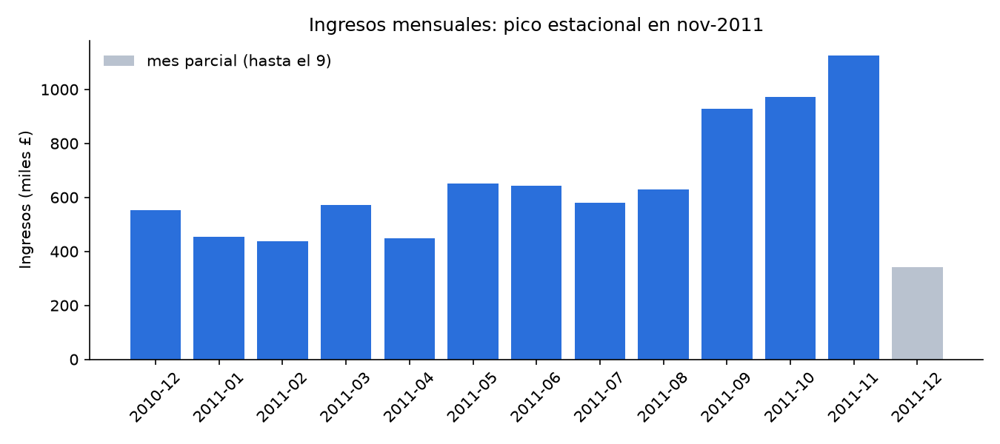
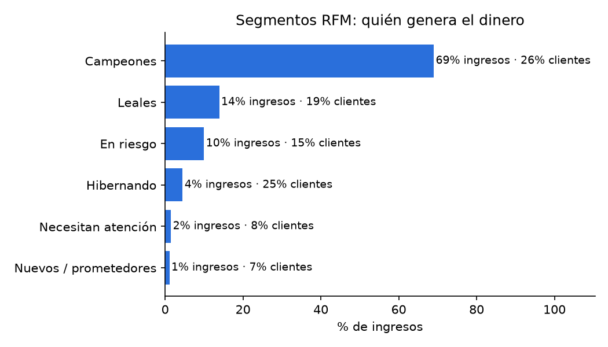

# Proyecto 1 · ¿De quién depende realmente una tienda online?

Análisis de un año de ventas de una tienda online británica de regalos: quién genera los ingresos, cuándo se vende más y a qué clientes conviene cuidar o recuperar.

**Datos:** [Online Retail, UCI](https://archive.ics.uci.edu/dataset/352/online+retail) · 541.909 transacciones (1-dic-2010 a 9-dic-2011).
**Herramientas:** Python (pandas, matplotlib) · SQL (SQLite) · HTML/JavaScript (Chart.js).

📖 **Para leer sin tecnicismos:** [LA_HISTORIA_DEL_PROYECTO.md](LA_HISTORIA_DEL_PROYECTO.md) (empresa, desafío, cómo se resolvió y recomendaciones).
📊 **Dashboard en vivo:** [https://leandrordr.github.io/Portfolio/01-ventas-retail/dashboard.html](https://leandrordr.github.io/Portfolio/01-ventas-retail/dashboard.html)

## Hallazgos
- El **26 %** de los clientes ("Campeones") genera el **69 %** de los ingresos.
- Noviembre factura más del doble que febrero; el aumento empieza en septiembre.
- **644 clientes "en riesgo"** suman el 10 % de los ingresos: objetivo de reactivación.
- Solo **1 de cada 5** clientes nuevos (19,7 %) vuelve a comprar al mes siguiente.




## Método
1. **Limpieza (pandas):** duplicados, cancelaciones, ventas anuladas por completo, cantidades/precios inválidos, códigos que no son productos y líneas sin cliente. Se conserva el 71,6 % de las filas.
2. **SQL (SQLite):** agregaciones, CTEs, funciones de ventana y `NTILE` (`queries.sql`).
3. **Segmentación RFM:** recencia, frecuencia y valor monetario por cliente.
4. **Cohortes:** retención de clientes mes a mes.
5. **Visualización:** gráficos con matplotlib y dashboard web para público no técnico.

## Estructura
| Archivo | Contenido |
|---|---|
| `analysis.py` | Script principal, comentado paso a paso |
| `queries.sql` | Consultas SQL |
| `build_dashboard.py` | Genera `dashboard.html` a partir de los resultados |
| `dashboard.html` | Dashboard para público no técnico |
| `LA_HISTORIA_DEL_PROYECTO.md` | El proyecto contado sin tecnicismos |
| `data/descargar_datos.py` | Descarga el dataset desde la UCI y lo deja como CSV |
| `output/` | Gráficos (PNG), resultados (JSON) y clientes segmentados (CSV) |

## Cómo reproducirlo
```
pip install -r requirements.txt
python data/descargar_datos.py     # descarga los datos (no se incluyen en el repo por su tamaño)
python analysis.py                 # limpieza, SQL, RFM, cohortes y gráficos
python build_dashboard.py          # genera dashboard.html
```

## Límites
Un solo año de datos (diciembre de 2011 incompleto) y cifras de clientes identificados: los hallazgos son asociaciones, no causas.
