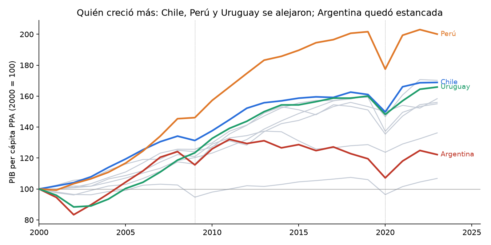

# Proyecto 2 · Crecimiento, inflación y empleo en América Latina

Comparación de 10 países latinoamericanos entre 2000 y 2023: quién mejoró más su nivel de vida, con qué estabilidad y cómo resistió las crisis de 2009 y 2020.

**Datos:** API pública del [Banco Mundial](https://data.worldbank.org/) · 10 países · 2000–2023.
**Herramientas:** Python (pandas, NumPy, matplotlib) · API REST · HTML/JavaScript (Chart.js).

📖 **Para leer sin tecnicismos:** [LA_HISTORIA_DEL_PROYECTO.md](LA_HISTORIA_DEL_PROYECTO.md)
📊 **Dashboard en vivo:** [https://leandrordr.github.io/Portfolio/02-economia-latam/dashboard.html](https://leandrordr.github.io/Portfolio/02-economia-latam/dashboard.html)

## Hallazgos
- **Perú** lidera el crecimiento del PIB per cápita (3,1 % anual); **México** casi no avanza (0,3 %).
- **Argentina** es atípica: volatilidad de 6,3 pp e inflación mediana del 51 % en 2018–23.
- Los países más pobres en 2000 crecieron más rápido (correlación −0,63, con solo 10 países).
- +1 pp de PIB se asocia con −0,18 pp de desempleo (ley de Okun; asociación, no causalidad).



## Método
1. **Descarga** de 5 indicadores con la API del Banco Mundial (`fetch_data.py`).
2. **Calidad de datos:** se detectan huecos (Argentina sin inflación 2000–2017) y se descarta la deuda pública por cobertura baja.
3. **Resumen por país:** CAGR del PIB per cápita, volatilidad, desempleo e inflación.
4. **Choques:** caída en 2009 y 2020 y año de recuperación del nivel de 2019.
5. **Relaciones:** ley de Okun (regresión), convergencia e inflación–crecimiento (correlaciones).

## Estructura
| Archivo | Contenido |
|---|---|
| `fetch_data.py` | Descarga los indicadores a `data/worldbank_latam.csv` |
| `analysis.py` | Análisis completo, comentado paso a paso |
| `build_dashboard.py` | Genera `dashboard.html` |
| `dashboard.html` | Tablero interactivo |
| `LA_HISTORIA_DEL_PROYECTO.md` | El proyecto contado sin tecnicismos |
| `data/` | Datos descargados (pesan poco, se incluyen) |
| `output/` | Gráficos (PNG), resultados (JSON) y resumen por país (CSV) |

## Cómo reproducirlo
```
pip install -r requirements.txt
python fetch_data.py         # opcional: ya hay una copia en data/
python analysis.py
python build_dashboard.py
```

## Límites
Argentina no tiene inflación publicada en 2000–2017; el desempleo es una estimación modelada de la OIT; con 10 países las conclusiones son orientativas.
