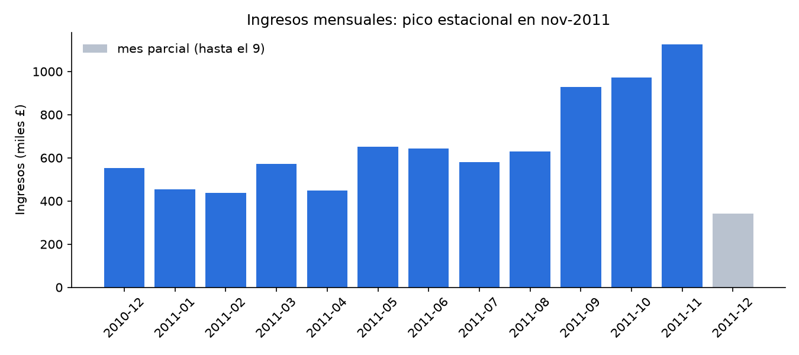

# Portfolio de Análisis de Datos

Hola, soy **Leandro Rodriguez del Rio**. Este repositorio reúne mis proyectos de análisis de datos con datos públicos reales: cada uno parte de una pregunta de negocio, pasa por limpieza, análisis y visualización, y termina en conclusiones accionables.

## Proyectos

| # | Proyecto | Pregunta que responde | Herramientas | |
|---|---|---|---|---|
| 1 | **[Ventas y segmentación de clientes](01-ventas-retail/)** | ¿De quién depende una tienda online, cuándo vende más y a qué clientes conviene recuperar? | Python · pandas · SQL (SQLite) · matplotlib · Chart.js | [**Dashboard**](https://leandrordr.github.io/Portfolio/01-ventas-retail/dashboard.html) · [Historia](01-ventas-retail/LA_HISTORIA_DEL_PROYECTO.md) · [Código](01-ventas-retail/analysis.py) |

*Más proyectos próximamente.*

### Proyecto 1 de un vistazo
- El **26 %** de los clientes genera el **69 %** de las ventas.
- Las ventas de noviembre duplican las de febrero.
- Solo **1 de cada 5** clientes nuevos vuelve a comprar al mes siguiente.



## Habilidades que muestran estos proyectos
- **Limpieza y calidad de datos:** duplicados, devoluciones, valores atípicos, documentación de lo que se descarta y por qué.
- **SQL analítico:** CTEs, funciones de ventana, `NTILE`, cohortes.
- **Análisis en Python:** pandas, segmentación RFM, retención por cohortes.
- **Visualización y comunicación:** gráficos y dashboards pensados para públicos técnicos y no técnicos.

## Cómo está organizado
Cada proyecto vive en su propia carpeta numerada y es independiente:
```
Portfolio/
├── README.md                 ← esta página
└── 01-ventas-retail/
    ├── README.md             ← resumen, método y cómo reproducirlo
    ├── LA_HISTORIA_DEL_PROYECTO.md   ← el proyecto contado sin tecnicismos
    ├── analysis.py · queries.sql · build_dashboard.py
    ├── dashboard.html
    ├── data/                 ← script para descargar los datos
    └── output/               ← gráficos y resultados
```
Los datos originales no se incluyen por su tamaño; cada proyecto trae el script para descargarlos.
